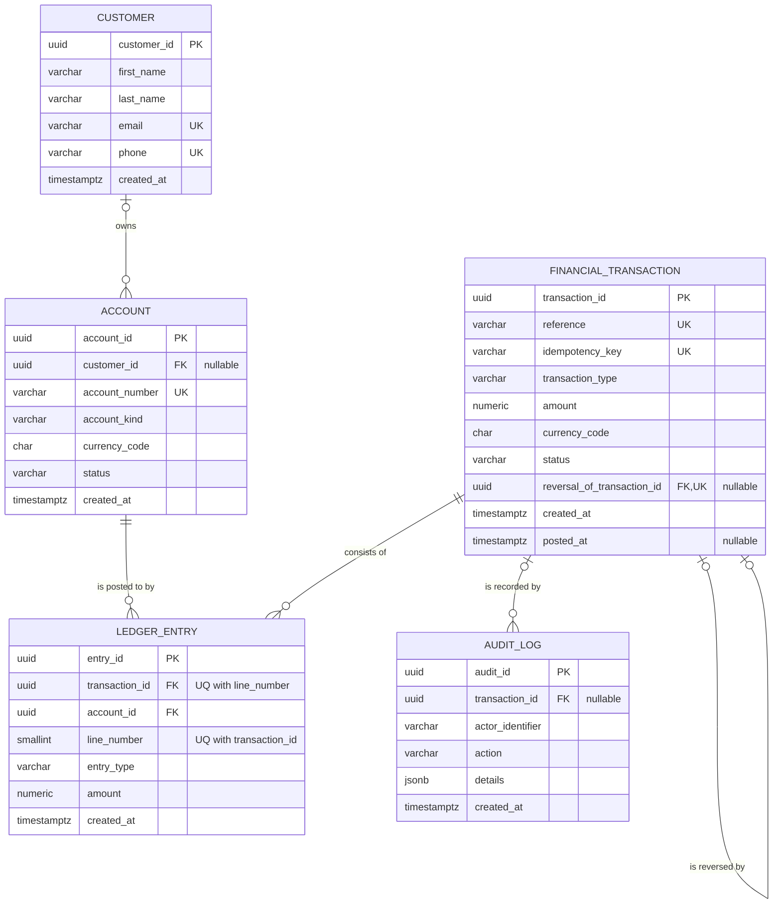

# Portfolio 1: Database Design and Modelling

MIT 8103 Advanced Database Systems, 2026/2027 Academic Session, First Semester Continuous Assessment

| File | Contents |
| --- | --- |
| [schema.sql](schema.sql) | Executable schema: tables, keys, constraints, triggers and the balance view |
| [seed.sql](seed.sql) | Simulated sample data |
| [test_constraints.sql](test_constraints.sql) | Tests that invalid data is rejected |
| [evidence/test-results.txt](evidence/test-results.txt) | Output of the test run |

## 1. Chosen Case Study

**ClearPay Digital Fintech Platform (a simulated organisation).**

ClearPay allows customers to maintain accounts, deposit money, withdraw funds, and transfer money to other customers within the platform. The database stores customer information, accounts, financial transactions, ledger entries, and audit logs. It supports accurate record keeping, prevents invalid transactions, and preserves completed and reversed transaction histories.

| Database user | Responsibilities |
| --- | --- |
| Customers | View balances, transfer funds, and view transaction history |
| Customer support officers | Investigate failed transactions and complaints |
| Finance officers | Reconcile transactions and process authorised reversals |
| Compliance and audit officers | Review transaction records and audit logs |
| System administrators | Manage access, availability, and maintenance |

| Data stored | Operations supported |
| --- | --- |
| Customer profiles | Register customers and update contact information |
| Accounts | Create accounts, check balances, and restrict accounts |
| Transactions | Record deposits, withdrawals, transfers, and reversals |
| Ledger entries | Record debit and credit effects of posted transactions |
| Audit logs | Record important activities and changes |

### Scope and assumptions

- Each customer may own multiple accounts; each customer account belongs to one customer.
- Internal settlement accounts have no customer owner and provide the other side of deposits and withdrawals. A deposit credits the customer account and debits an internal settlement account.
- Each account holds one currency. Transfers occur within the platform; foreign exchange and cross-currency transfers are outside scope.
- Every posted financial transaction produces balanced debit and credit ledger entries.
- A full reversal is a new transaction linked to the original. Original records remain available. Partial reversals and joint accounts are outside scope.

## 2. Entity-Relationship Diagram



- **Customer to account:** an account has zero or one customer (internal settlement accounts have none), and a customer has zero or more accounts.
- **Transaction to ledger entry:** a transaction has no financial effect while pending or failed. A posted transaction must have at least two balanced entries.
- **Transaction to audit log:** audit records may reference a transaction or represent a general system event.
- **Self-reference:** an original transaction may have zero or one full reversal, and each reversal identifies one original transaction.

## 3. Relational Schema

The full definitions are in [schema.sql](schema.sql). In this summary, PK = primary key, FK = foreign key, UQ = unique, and NN = NOT NULL.

```text
CUSTOMER (
  customer_id UUID PK,
  first_name VARCHAR(100) NN, last_name VARCHAR(100) NN,
  email VARCHAR(255) NN UQ, phone VARCHAR(20) NN UQ,
  created_at TIMESTAMPTZ NN
)

ACCOUNT (
  account_id UUID PK,
  customer_id UUID FK -> CUSTOMER.customer_id (nullable),
  account_number VARCHAR(20) NN UQ,
  account_kind VARCHAR(20) NN, currency_code CHAR(3) NN,
  status VARCHAR(20) NN, created_at TIMESTAMPTZ NN
)

FINANCIAL_TRANSACTION (
  transaction_id UUID PK,
  reference VARCHAR(50) NN UQ,
  idempotency_key VARCHAR(100) NN UQ,
  transaction_type VARCHAR(20) NN,
  amount NUMERIC(18,2) NN, currency_code CHAR(3) NN,
  status VARCHAR(20) NN,
  reversal_of_transaction_id UUID UQ FK -> FINANCIAL_TRANSACTION.transaction_id (nullable),
  created_at TIMESTAMPTZ NN, posted_at TIMESTAMPTZ (nullable)
)

LEDGER_ENTRY (
  entry_id UUID PK,
  transaction_id UUID NN FK -> FINANCIAL_TRANSACTION.transaction_id,
  account_id UUID NN FK -> ACCOUNT.account_id,
  line_number SMALLINT NN, entry_type VARCHAR(6) NN,
  amount NUMERIC(18,2) NN, created_at TIMESTAMPTZ NN,
  UQ (transaction_id, line_number)
)

AUDIT_LOG (
  audit_id UUID PK,
  transaction_id UUID FK -> FINANCIAL_TRANSACTION.transaction_id (nullable),
  actor_identifier VARCHAR(100) NN, action VARCHAR(100) NN,
  details JSONB NN, created_at TIMESTAMPTZ NN
)
```

Design decisions:

- **Account numbers are text** to preserve leading zeroes.
- **Account kind** distinguishes customer accounts from internal settlement accounts.
- **A unique idempotency key** stops a retried request from creating another transaction.
- **A nullable unique reversal reference** permits ordinary transactions without a reference while preventing multiple full reversals of one original. PostgreSQL treats NULLs as distinct in a unique constraint, so any number of ordinary transactions can leave it empty.
- **Audit logs** record operational evidence, such as who initiated a reversal, in flexible JSONB. Financial amounts and postings remain in the structured transaction and ledger tables.

## 4. Keys

| Table | Primary key | Other unique keys | Foreign keys |
| --- | --- | --- | --- |
| CUSTOMER | customer_id | email; phone | None |
| ACCOUNT | account_id | account_number | customer_id |
| FINANCIAL_TRANSACTION | transaction_id | reference; idempotency_key; reversal_of_transaction_id (nullable) | reversal_of_transaction_id |
| LEDGER_ENTRY | entry_id | (transaction_id, line_number) | transaction_id; account_id |
| AUDIT_LOG | audit_id | None | transaction_id |

## 5. Constraints and Business Rules

**Entity and referential integrity:** primary keys identify records uniquely, and foreign keys prevent references to records that do not exist. Foreign keys use `ON DELETE RESTRICT` to preserve referenced financial records. Accounts are closed through a status change rather than by deleting their financial history.

### 5.1 Domain constraints

| Field | Permitted values or condition | Constraint |
| --- | --- | --- |
| ACCOUNT.account_kind | CUSTOMER or INTERNAL | `account_kind_check` |
| ACCOUNT.status | ACTIVE, FROZEN, or CLOSED | `account_status_check` |
| ACCOUNT owner | Customer accounts have an owner; internal accounts do not | `account_owner_check` |
| transaction_type | DEPOSIT, WITHDRAWAL, TRANSFER, or REVERSAL | `ft_type_check` |
| Transaction status | PENDING, POSTED, or FAILED | `ft_status_check` |
| Reversal link | Set for reversals only, and never to the transaction itself | `ft_reversal_link_check`, `ft_not_self_reversal_check` |
| posted_at | Set only when the status is POSTED | `ft_posted_at_check` |
| LEDGER_ENTRY.entry_type | DEBIT or CREDIT | `le_type_check` |
| Transaction and entry amount | Greater than zero; NUMERIC(18,2) | `ft_amount_check`, `le_amount_check` |
| line_number | Greater than zero | `le_line_number_check` |
| currency_code | NGN or USD in this portfolio | `account_currency_check`, `ft_currency_check` |

### 5.2 Financial integrity rules

Rules involving multiple rows or tables cannot be enforced by an ordinary row-level CHECK constraint, so they use triggers or are left to the posting procedure.

| Rule | Enforcement | Status |
| --- | --- | --- |
| Posted debits equal posted credits, and equal the transaction amount | Deferred constraint trigger, checked at COMMIT | Implemented and tested |
| Currency consistency | Same deferred trigger | Implemented and tested |
| Different transfer accounts | Same deferred trigger | Implemented and tested |
| Valid reversal: posted original, same amount and currency, inverted entries | Same deferred trigger | Implemented and tested |
| Immutable posted entries | `ledger_entry_guard` and `financial_transaction_guard` triggers | Triggers implemented and tested; role permissions not yet set up |
| No balance impact before posting | `customer_account_balance` view counts posted entries only | Implemented and tested |
| Sufficient available funds | Lock the relevant accounts, calculate the balance, then validate before posting | Planned for the posting procedure in Portfolio 3 |
| Account eligibility | Only eligible active accounts initiate ordinary transfers or withdrawals | Planned for the posting procedure in Portfolio 3 |
| Rejecting a reused idempotency key with different request details | Compare the stored request with the retry | Planned for the posting procedure in Portfolio 3; the unique key already blocks a second row |

The check is deferred because a transaction and its entries are written across several statements. It can only be judged once they are all in place, which is at COMMIT.

### Account balance and transfer example

For customer deposit accounts: **Balance = total posted credits - total posted debits.** Deriving balances from the ledger avoids maintaining a second independent balance value that could disagree with the financial history.

| Transaction | Account | Entry type | Amount |
| --- | --- | --- | --- |
| TX001 | Customer A | DEBIT | NGN 5,000 |
| TX001 | Customer B | CREDIT | NGN 5,000 |

The debit reduces Customer A's balance, and the credit increases Customer B's balance. Both entries must be posted within the same database transaction.

## 6. Normalisation

Normalisation organises data to reduce unnecessary duplication and prevent insertion, update, and deletion anomalies. This design targets Third Normal Form (3NF).

**First Normal Form (1NF).** Each field holds a single value and repeating groups are removed. Customers, accounts, and ledger entries occupy separate rows. Multiple accounts or transactions are not stored as comma-separated lists inside a customer record. `AUDIT_LOG.details` is JSONB, but it holds supplementary evidence that is not queried as relational data, and no financial values depend on it.

**Second Normal Form (2NF).** A relation is in 2NF when it is in 1NF and every non-key attribute depends on the whole of every candidate key, with no partial dependencies. Most tables have single-column keys. In LEDGER_ENTRY, the alternative composite key is (transaction_id, line_number); account, entry type, and entry amount depend on the complete combination. Transaction reference and status are stored in FINANCIAL_TRANSACTION rather than repeated on ledger lines, where they would depend only on transaction_id.

**Third Normal Form (3NF).** A relation is in 3NF when it is in 2NF and non-key attributes do not depend transitively on a key through another non-key attribute. For example, account_id identifies customer_id, which identifies the customer email. Keeping the email in CUSTOMER prevents a transitive dependency within ACCOUNT. Customer names are not repeated in account or ledger rows, and ledger entries reference account_id rather than repeating account numbers.

### Main functional dependencies

```text
customer_id -> first_name, last_name, email, phone, created_at
account_id -> customer_id, account_number, account_kind,
              currency_code, status, created_at
transaction_id -> reference, idempotency_key, transaction_type,
                  amount, currency_code, status,
                  reversal_of_transaction_id, created_at, posted_at
entry_id -> transaction_id, account_id, line_number,
            entry_type, amount, created_at
(transaction_id, line_number) -> entry_id, account_id,
                                 entry_type, amount, created_at
audit_id -> transaction_id, actor_identifier, action,
            details, created_at
```

The other unique columns (such as email or reference) are also candidate keys, so they determine their rows too. Because every determinant above is a candidate key, the listed dependencies also satisfy Boyce-Codd Normal Form.

Transaction amount describes the business event, while ledger amounts describe its individual postings. This looks like duplication, but they are different facts, and the deferred trigger validates their relationship at posting.

| Anomaly | Prevention |
| --- | --- |
| Update | A customer email is updated once in CUSTOMER |
| Insertion | Customers and accounts can exist before financial transactions |
| Deletion | Deleting an unposted request does not remove customer or account data; posted financial records are retained |
| Inconsistent history | Corrections use linked reversals, preserving original entries |

## 7. Implementation and Testing

Tested on PostgreSQL 15.13. To reproduce, from this folder:

```bash
createdb clearpay
psql -d clearpay -v ON_ERROR_STOP=1 -f schema.sql
psql -d clearpay -f seed.sql
psql -d clearpay -f test_constraints.sql
```

The seed data posts a NGN 20,000 deposit, transfers of NGN 5,000 and NGN 2,000, and a full reversal of the second transfer. It also leaves a NGN 1,000 transfer pending.

| Check | Expected | Result |
| --- | --- | --- |
| Balance of account 0012345601 | 20,000 - 5,000 - 2,000 + 2,000 = 15,000; the pending 1,000 is ignored | 15,000.00 |
| Balance of account 0012345602 | 5,000 + 2,000 - 2,000 = 5,000; the pending 1,000 is ignored | 5,000.00 |
| Invalid operations rejected | 36 of 36, each with the expected constraint or message | 36 passed, 0 failed |
| Real COMMIT of an unbalanced transfer | COMMIT fails and leaves no rows | Failed at COMMIT, 0 rows left |

Each rejection test attempts an invalid operation and passes only if the database refuses it with the expected constraint or message. A test fails if the operation succeeds, or if it is refused for a different reason. The full output is in [evidence/test-results.txt](evidence/test-results.txt).

**Limits of this testing:**

- All tests ran in a single session, so concurrent behaviour was not exercised. That includes the row lock in `ledger_entry_guard`, which is left for Portfolio 3.
- A superuser or `TRUNCATE` can bypass the row-level immutability triggers. Role permissions would close this gap and are not yet set up.
- No indexes have been added beyond those created by primary keys and unique constraints. Index choices are left for Portfolio 2, where they can be measured before and after.

## AI Use Declaration

- **Tools used:** ChatGPT and Claude Code (Claude Opus 5.5).
- **ChatGPT was used for:** drafting the case study description.
- **Claude Code was used for:** converting that design into this README, writing `schema.sql`, `seed.sql` and `test_constraints.sql`, and running the tests that produced `evidence/test-results.txt`.

